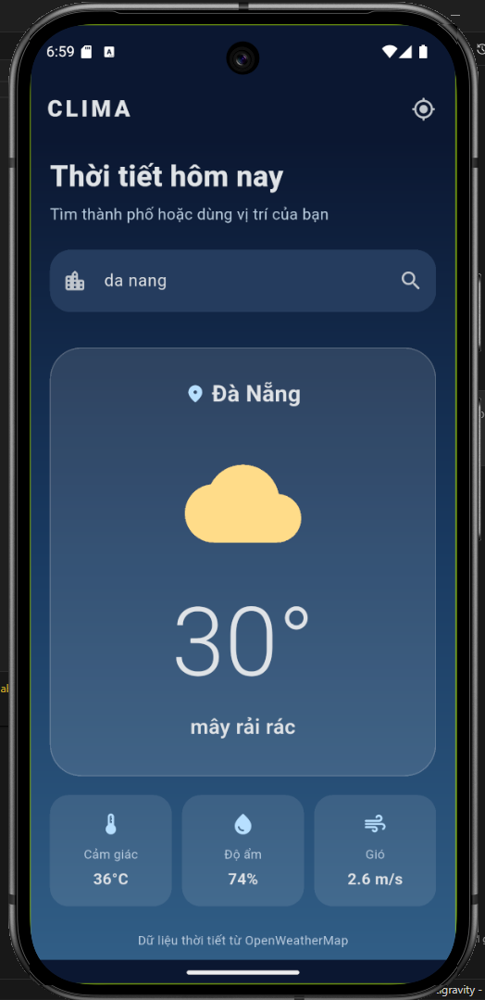

# Flutter Lab 09 — Clima

Ứng dụng thời tiết Flutter dùng OpenWeatherMap Current Weather API. Người dùng có thể tra thời tiết theo tên thành phố hoặc vị trí hiện tại của thiết bị. Màn hình hiển thị nhiệt độ, mô tả, biểu tượng thời tiết, nhiệt độ cảm nhận, độ ẩm và tốc độ gió.

## Ảnh ứng dụng



## Cấu hình và chạy

1. Tạo tài khoản và lấy API key tại [OpenWeatherMap](https://home.openweathermap.org/api_keys). Key mới có thể cần thời gian để được kích hoạt.
2. Mở **`config/api_key.txt`** và dán key thật vào một dòng riêng, không thêm dấu nháy. Tệp này đã có sẵn trên máy hiện tại. Nếu tải dự án từ GitHub, hãy tạo tệp đó dựa trên `config/api_key.example.txt`.
3. Chọn thiết bị Android/emulator trong Android Studio rồi bấm **Run ▶**. Không cần chạy lệnh trong terminal hoặc chỉnh `Additional run args`. Sau mỗi lần đổi key, hãy dừng ứng dụng và bấm Run lại; hot reload không thay key đã đóng gói.
4. Nhập thành phố rồi bấm kính lúp, hoặc bấm nút định vị ở góc trên và cấp quyền khi Android hỏi.

`config/api_key.txt` được `.gitignore` bỏ qua để không đưa key lên GitHub. Có thể dùng `--dart-define=OPENWEATHER_API_KEY=...` như cách cũ nếu không có key trong tệp; key trong tệp được ưu tiên. Key vẫn có thể bị trích xuất từ APK đã biên dịch, nên ứng dụng sản xuất cần một backend bảo vệ key. Nếu chưa cấu hình key, giao diện vẫn chạy và hiển thị hướng dẫn, nhưng không thể tải dữ liệu thời tiết thật.

## Cấu trúc

- `lib/screens/weather_page.dart`: giao diện, trạng thái tải/lỗi và thao tác người dùng.
- `lib/services/networking.dart`: HTTP request, xử lý status code và JSON.
- `lib/services/location.dart`: xin quyền và lấy vị trí hiện tại bằng geolocator.
- `lib/weather_model.dart`: dữ liệu thời tiết và biểu tượng theo condition ID.

Ứng dụng chỉ cấu hình nền tảng Android. Android Manifest khai báo quyền Internet và vị trí; ứng dụng chỉ xin quyền vị trí khi người dùng bấm nút định vị. Không sử dụng vị trí nền.

## Kiểm tra

```bash
flutter analyze
flutter test
flutter build apk --debug
```

Tham khảo: [OpenWeatherMap Current Weather API](https://openweathermap.org/api/current), [geolocator](https://pub.dev/packages/geolocator), [http](https://pub.dev/packages/http).
